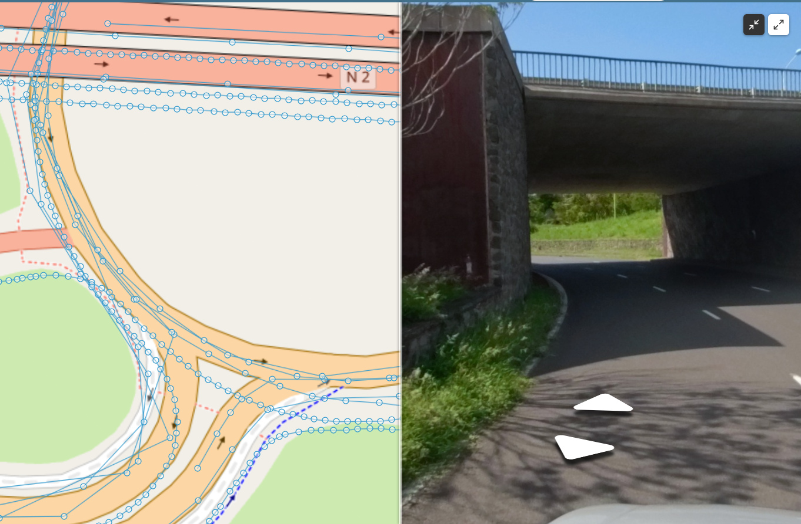
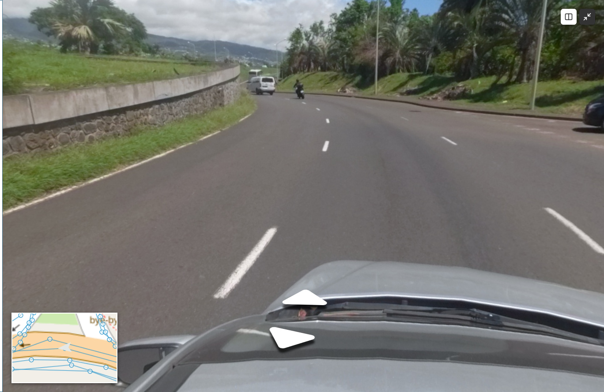

# (FR) Panoramax

_English below_

Ce script affiche dans Lizmap Web les photos du projet Panoramax (https://panoramax.fr). Les instances panoramax utilisées sont les instances IGN (https://panoramax.ign.fr) et OpenStreetMap France (https://panoramax.openstreetmap.fr).

Deux fichiers :

- **`panoramax4_3.9.js`** : **VERSION RECOMMANDEE**. Utilise le web-viewer Panoramax V4 (Web Components) et crée lui-même les couches de points Panoramax dans la carte.
- **`panoramax3_3.9.legacy.js`** : ancienne version basée sur l'API V3 et sur une couche Panoramax ajoutée dans le projet QGIS. Conservée pour référence, elle n'est plus maintenue et ne propose pas les modes d'affichage décrits plus bas.

## Pré-requis

- Lizmap Web Client 3.9.
- Le navigateur doit pouvoir joindre le CDN jsDelivr (web-viewer Panoramax 4.4.0), l'API `api.panoramax.xyz` et les serveurs de tuiles `panoramax.ign.fr` et `panoramax.openstreetmap.fr`.
- Aucune couche Panoramax n'est nécessaire dans le projet QGIS : le script ajoute lui-même deux couches de tuiles vectorielles (IGN et OSM) à la carte quand le panneau est ouvert.
- Aucune contrainte de projection : OpenLayers reprojette les tuiles à la volée.

## Installation

1. Copier `panoramax4_3.9.js` dans le dossier `media/js/default` du répertoire Lizmap (ou `media/js/nom_du_projet` pour un seul projet).
2. Recharger la carte : un bouton avec une icône appareil photo apparaît dans la barre de gauche.

## Utilisation

1. Cliquer sur le bouton Panoramax : le minidock s'ouvre avec le visualiseur, et les points Panoramax s'affichent sur la carte.
2. Cliquer sur un point : la photo correspondante s'affiche. Une flèche indique l'azimut de la vue et la carte se centre sur la photo.
3. Naviguer dans les photos avec les flèches du visualiseur ou le lecteur sous l'image : la carte et la flèche suivent chaque photo.
4. Fermer le minidock : les couches Panoramax sont masquées et la disposition revient à la normale.

## Modes d'affichage (position minidock)

Deux boutons en haut à droite du visualiseur Panoramax permettent de changer la disposition de la page :

- **Moitié d'écran.** La zone carte est partagée entre la carte à gauche et les photos à droite. Il est possible de déplacer le séparateur entre les deux panneaux en faisant glisser celui-ci vers la droite ou vers la gauche (part de la carte entre 20 % et 80 %, 50 % par défaut). La carte continue de suivre la navigation dans les photos.

  

- **Pleine carte.** Les photos de Panoramax prennent toute la zone carte et la carte devient une vignette en bas à gauche, toujours centrée sur la photo courante. Un clic sur la vignette de la carte rétablit la disposition.

  

Un second clic sur le bouton actif, ou la fermeture du minidock, rétablit la disposition normale. On peut passer directement d'un mode à l'autre. Si un panneau Lizmap est ouvert (couches, impression, etc.), la carte et les photos se placent à sa droite et suivent son ouverture ou sa fermeture.

Les deux modes sont masqués en affichage mobile et n'existent pas quand `DOCK_POSITION` vaut `dock`.

## Personnalisation

Les constantes en tête du script, au-dessus de la ligne "DO NOT MODIFY BELOW THIS LINE" :

| Constante | Rôle | Valeur par défaut |
|---|---|---|
| `DOCK_POSITION` | `minidock` ou `dock`. Les modes d'affichage n'existent qu'en `minidock` | `minidock` |
| `DOCK_ICON`, `DOCK_TITLE` | Icône et titre du bouton | `icon-camera`, `Panoramax` |
| `SPLIT_DEFAULT_PERCENT` | Part de la carte (à gauche) en moitié d'écran | `50` |
| `SPLIT_MIN_PERCENT`, `SPLIT_MAX_PERCENT` | Bornes du séparateur | `20`, `80` |
| `MAP_THUMBNAIL_WIDTH`, `MAP_THUMBNAIL_HEIGHT` | Taille de la vignette carte en pleine carte (px) | `240`, `160` |
| `MAP_THUMBNAIL_MARGIN` | Distance de la vignette aux bords bas et gauche (px) | `20` |
| `ARROW_ICON_SIZE`, `ARROW_ICON_COLOR` | Taille et couleur de la flèche d'azimut | `0.3`, `#e4e8e6` |
| `PANORAMAX_INSTANCE` | API utilisée par le visualiseur | `https://api.panoramax.xyz/api` |
| `CONTENT_TEXT` | Textes du panneau et des boutons, par langue (fr, en, it, es, de, pt, nl, pl). La langue du navigateur est utilisée, `en` par défaut | - |
| `DEBUG_MODE` | Messages de diagnostic dans la console | `false` |

Plus bas dans le script, `PANORAMAX_SOURCES` liste les serveurs de tuiles (URL et zoom maximum) et`PANORAMAX_LAYER_CONFIG` le nom, la visibilité initiale et le z-index des couches. Le style des points est défini dans la méthode `#setPanoramaxLayerStyle()`.

## Limites connues

- En moitié d'écran, les boutons de zoom Lizmap (en haut à droite de la zone carte) sont sous le visualiseur. La carte reste manipulable à la souris.
- Le mode et la répartition ne sont pas conservés d'une session à l'autre.

# (EN) Panoramax

This script displays photos from the Panoramax project (https://panoramax.fr) in Lizmap Web Client, using the IGN (https://panoramax.ign.fr) and OpenStreetMap France (https://panoramax.openstreetmap.fr) instances.

Two files are provided:

- **`panoramax4_3.9.js`**: **RECOMMENED VERSION**. Uses the Panoramax V4 web-viewer (Web Components) and creates the Panoramax point layers in the map by itself.
- **`panoramax3_3.9.legacy.js`**: former version based on the V3 API and on a Panoramax layer added to the QGIS project. Kept for reference, no longer maintained, should not be used, without the display modes described below.

## Requirements

- Lizmap Web Client 3.9.
- The browser must reach the jsDelivr CDN (Panoramax web-viewer 4.4.0), the `api.panoramax.xyz` API and the `panoramax.ign.fr` and `panoramax.openstreetmap.fr` tile servers.
- No Panoramax layer is needed in the QGIS project: the script adds two vector tile layers (IGN and OSM) to the map when the panel is open.
- No projection constraint: OpenLayers reprojects the tiles on the fly (tested on an EPSG:2975 project).

## Installation

1. Copy `panoramax4_3.9.js` to the `media/js/default` folder of the Lizmap repository (or `media/js/project_name` for a single project).
2. Reload the map: a button with a camera icon appears in the left bar.

## Usage

1. Click the Panoramax button: the minidock opens with the viewer, and the Panoramax points are displayed on the map.
2. Click a point: the matching photo is displayed. An arrow shows the view azimuth and the map is centred on the photo.
3. Browse the photos with the viewer arrows or the player under the picture: the map and the arrow follow each photo.
4. Close the minidock: the Panoramax layers are hidden and the layout goes back to normal.

## Display modes (minidock position)

Two buttons at the top right of the viewer change the page layout:

- **Half screen.** The map area is shared between the map on the left and the photos on the right. A splitter between them can be dragged (map share between 20% and 80%, 50% by default). The map keeps following the photo navigation.

  

- **Full map.** The photos take the whole map area and the map becomes a thumbnail at the bottom left, still centred on the current photo. Clicking the thumbnail restores the layout.

  

A second click on the active button, or closing the minidock, restores the normal layout. Switching directly from one mode to the other works. If a Lizmap panel is open (layers, print, etc.), the map and the photos are placed to its right and follow it when it opens or closes.

Both modes are hidden on the mobile layout and do not exist when `DOCK_POSITION` is `dock`.

## Customization

Constants at the top of the script, above the "DO NOT MODIFY BELOW THIS LINE" marker:

| Constant | Purpose | Default |
|---|---|---|
| `DOCK_POSITION` | `minidock` or `dock`. Display modes only exist in `minidock` | `minidock` |
| `DOCK_ICON`, `DOCK_TITLE` | Button icon and title | `icon-camera`, `Panoramax` |
| `SPLIT_DEFAULT_PERCENT` | Map share (left side) in half-screen mode | `50` |
| `SPLIT_MIN_PERCENT`, `SPLIT_MAX_PERCENT` | Splitter bounds | `20`, `80` |
| `MAP_THUMBNAIL_WIDTH`, `MAP_THUMBNAIL_HEIGHT` | Map thumbnail size in full-map mode (px) | `240`, `160` |
| `MAP_THUMBNAIL_MARGIN` | Thumbnail distance from the bottom and left edges (px) | `20` |
| `ARROW_ICON_SIZE`, `ARROW_ICON_COLOR` | Azimuth arrow size and colour | `0.3`, `#e4e8e6` |
| `PANORAMAX_INSTANCE` | API used by the viewer | `https://api.panoramax.xyz/api` |
| `CONTENT_TEXT` | Panel and button texts per language (fr, en, it, es, de, pt, nl, pl). The browser language is used, `en` as fallback | - |
| `DEBUG_MODE` | Diagnostic messages in the console | `false` |

Further down, `PANORAMAX_SOURCES` lists the tile servers (URL and maximum zoom) and `PANORAMAX_LAYER_CONFIG` the name, initial visibility and z-index of the layers. The point style is defined in the `#setPanoramaxLayerStyle()` method.

## Known limits

- In half-screen mode the Lizmap zoom buttons (top right of the map area) sit under the viewer. The map can still be panned and zoomed with the mouse.
- The mode and the split ratio are not kept between sessions.
